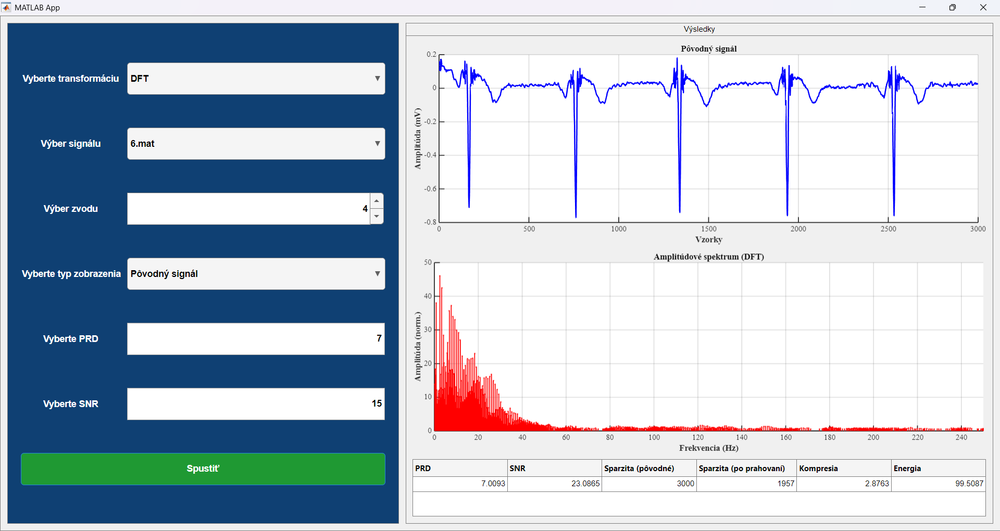
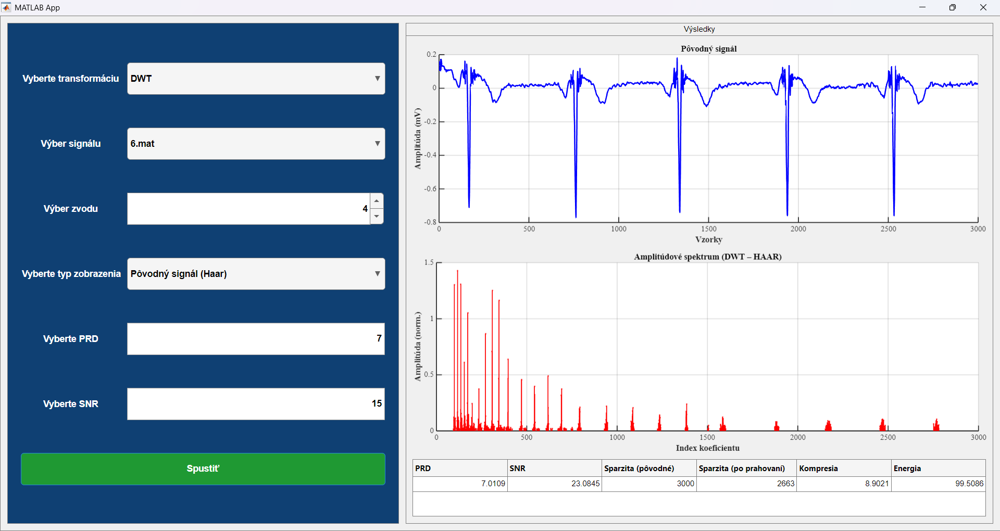
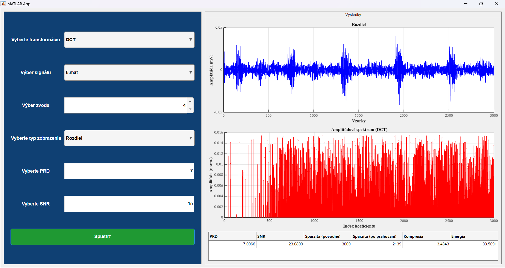

# Signal Sparsity Analysis: DFT, DCT, DWT

**Bachelor's thesis: Analysis of Signal Sparsity in DOT**
*(Slovak original: "Analýza sparsity signálov v DOT")*

A MATLAB application for comparing the sparsity of ECG signals and the quality of their reconstruction
in the Fourier, cosine and wavelet domains.

Author: Anzhelika Nikolaieva, 2026

[Slovenská verzia](README.sk.md)

---

## Table of Contents

- [Overview](#overview)
- [Screenshots](#screenshots)
- [Requirements](#requirements)
- [Getting Started](#getting-started)
- [Repository Structure](#repository-structure)
- [Signal Database](#signal-database)
- [Using the Application](#using-the-application)
- [Methodology](#methodology)
- [Metrics](#metrics)
- [Outputs](#outputs)
- [Notes and Limitations](#notes-and-limitations)

---

## Overview

This project is an interactive application built with **MATLAB App Designer** (`number_2.mlapp`).
It lets you examine how compactly a real ECG signal can be represented in three transform domains:

| Transform | Description |
|-----------|-------------|
| **DFT** | Discrete Fourier Transform (computed with the FFT) |
| **DCT** | 1D Discrete Cosine Transform |
| **DWT** | Discrete Wavelet Transform, 5 decomposition levels, **Haar** and **db2** wavelets |

For a chosen target reconstruction quality (**PRD** or **SNR**), the application finds the **smallest number of
coefficients** that still meets that target. It then displays the original, reconstructed and difference signals
together with their spectra and a table of metrics (sparsity, compression ratio, retained energy).

## Screenshots

All screenshots use signal `6.mat`, lead 4 and a target PRD of 7 %.

### Original signal and DFT spectrum



*Left: the controls. Right: the original signal in the time domain (top), its amplitude spectrum (middle) and the metrics table (bottom).*

### DFT reconstruction


*The signal reconstructed from the retained DFT coefficients, together with its spectrum.*

### DWT (Haar)



*DWT with the Haar wavelet. The right plot shows the absolute values of the wavelet coefficients by coefficient index (the approximation block is suppressed for display only).*

### DCT: difference signal



*The reconstruction error (original minus reconstructed signal) for DCT, and the amplitudes of its DCT coefficients.*

### Example results

Values read from the metrics table in the screenshots (signal `6.mat`, lead 4, target PRD = 7 %):

| Transform | PRD [%] | SNR [dB] | Nonzero coefficients | Compression ratio | Retained energy [%] |
|-----------|---------|----------|----------------------|-------------------|---------------------|
| DFT | 7.0093 | 23.0865 | 1043 | 2.8763 | 99.5087 |
| DCT | 7.0066 | 23.0899 | 861 | 3.4843 | 99.5091 |
| DWT (Haar) | 7.0109 | 23.0845 | 337 | 8.9021 | 99.5086 |

Nonzero coefficients are computed as `N - Sparzita (po prahovaní)` with `N = 3000`. For DFT the count includes both the positive and the negative frequency bins. The values illustrate the metrics for a single signal and are not a general comparison of the transforms.

## Requirements

- **MATLAB R2024b** (the release the app was tested with), with App Designer. Other releases may not support all UI properties used by the app.
- **Signal Processing Toolbox**: `dct`, `idct`
- **Wavelet Toolbox**: `wavedec`, `waverec`

## Getting Started

1. Clone or download the repository:
   ```bash
   git clone https://github.com/akill6/signal-sparsity-dot.git
   ```
2. Open MATLAB.
3. Open `number_2.mlapp`.
4. Click **Run**.
5. On the start screen, click **Začať analýzu** ("Start analysis").

> The application looks for the signal database in the `matDBs/` folder **located next to `number_2.mlapp`**.
> Do not move the `.mlapp` file without the `matDBs` folder.

## Repository Structure

```
signal-sparsity-dot/
├── number_2.mlapp   # application (GUI + DFT / DCT / DWT computation)
├── matDBs/          # database of 200 ECG signals: 1.mat ... 200.mat
├── docs/            # screenshots used in this file
├── READ_ME.txt      # original short instructions and function overview (Slovak)
├── README.md        # this file (English)
├── README.sk.md     # Slovak version of this file
└── .gitignore
```

## Signal Database

The `matDBs/` folder contains **200 files**, `1.mat` through `200.mat`.

| Property | Value |
|----------|-------|
| Variable in each file | `ecgSignal` |
| Size | 5000 × 12 (samples × leads) |
| Data type | `double` |
| Sampling frequency | 500 Hz (set in the application code) |

The first **3000 samples** (6 s) of the selected lead are analyzed.
Files shorter than 3000 samples are rejected with an error message, and a file without an `ecgSignal`
variable triggers a loading error.

The signal list is sorted numerically by file name (1, 2, 3, ... 200), not alphabetically.

## Using the Application

The interface is in Slovak. English equivalents of the labels are given below.

### 1. Start screen

The **Začať analýzu** ("Start analysis") button hides the start panel, shows the main panel and loads the list of
signals from `matDBs/`. The first signal is selected automatically.

### 2. Main panel

| Control (Slovak label) | Meaning | Range / options |
|------------------------|---------|-----------------|
| **Výber signálu** | Select signal: a `.mat` file from `matDBs/` | `1.mat` ... `200.mat` |
| **Výber zvodu** | Select lead: column of the signal matrix | 1 to 12 |
| **Vyberte transformáciu** | Select transform | `DFT`, `DCT`, `DWT` |
| **Vyberte PRD** | Target PRD in % | 3 to 7 (default 3) |
| **Vyberte SNR** | Target SNR in dB | 15 to 25 (default 15) |
| **Spustiť** | Run the computation | n/a |
| **Vyberte typ zobrazenia** | Select what is plotted | Pôvodný signál (original) / Rekonštruovaný signál (reconstructed) / Rozdiel (difference) |

**PRD / SNR priority.** The application remembers which of the PRD and SNR fields you edited **last** and uses it as
the optimization target; the other field is ignored. If neither field has been edited, PRD is used.

**DWT mode.** For DWT, **both wavelets (Haar and db2)** are always computed, and the entries of the display-type list
gain a wavelet suffix, for example `Pôvodný signál (Haar)` or `Rozdiel (db2)`.

**Plot refresh.** The plots are redrawn when you press **Spustiť** and when you open the **Vyberte typ zobrazenia**
drop-down list.

### 3. Results

- **Left plot:** the signal in the time domain (x-axis: samples, y-axis: amplitude in mV)
- **Right plot:** amplitude spectrum (stem plot)
  - DFT: frequency axis from 0 to 250 Hz
  - DCT / DWT: coefficient index
- **Metrics table:** PRD, SNR, Sparzita (pôvodné), Sparzita (po prahovaní), Kompresia, Energia (column headers are in Slovak)

## Methodology

All three transforms use the same hard-thresholding principle, which keeps the results directly comparable:

1. The first 3000 samples of the selected lead are taken.
2. The signal is transformed (FFT / DCT / DWT).
3. Coefficients are sorted by absolute value in descending order.
4. A **binary search** finds the number of retained coefficients `k`:
   - the `k` largest coefficients are kept and the rest are set to zero,
   - the signal is reconstructed with the inverse transform,
   - PRD and SNR are computed,
   - the acceptance criterion is `PRD <= target + 0.01` (PRD mode) or `SNR >= target` (SNR mode),
   - of all tested values of `k`, the one closest to the target is selected.
5. A final reconstruction is made with the best `k`, and the metrics are computed.

If the binary search finds no suitable value, 90 % of the coefficients are retained.

### Transform-specific details

**DFT (`computeDFT`)**
- The DC component is always retained.
- Only positive frequencies (excluding DC) are ranked. When a frequency is kept, its complex-conjugate counterpart is
  kept too, so the reconstructed signal stays real.

**DCT (`computeDCT`)**
- A 1D DCT is used, and the first (DC) coefficient is always retained.

**DWT (`computeDWT`)**
- Multilevel decomposition (`wavedec`), 5 levels by default.
- All coefficients (approximation and details) are thresholded together.
- Results are stored separately for each wavelet (`haar`, `db2`), which allows sparsity to be compared between them.

## Metrics

Let `x` be the original signal, `x̂` the reconstructed signal, `e = x − x̂`, and `N = 3000`.

| Metric | Definition |
|--------|------------|
| **PRD** (Percent Root Difference) | `sqrt( Σe² / Σx² ) · 100` [%] |
| **SNR** (Signal-to-Noise Ratio) | `10 · log10( Σx² / Σe² )` [dB] |
| **Sparzita (pôvodné)** (original sparsity) | `N` (signal length) |
| **Sparzita (po prahovaní)** (sparsity after thresholding) | `N − number of nonzero coefficients` |
| **Kompresia** (compression ratio) | `N / number of nonzero coefficients` |
| **Energia** (retained energy) | `Σ abs(retained coefficients)² / Σ abs(all coefficients)² · 100` [%] |

## Outputs

- time-domain waveform of the original signal,
- reconstructed signal,
- difference signal (reconstruction error),
- spectral representations (original, reconstructed and difference signals),
- metrics table.

## Notes and Limitations

- **Do not place other panels above the main panel `app.Panel`** in App Designer. The signal database is loaded when
  the **Začať analýzu** button on that panel is pressed, so if another panel (for example `app.Panel_2`) is placed
  above `app.Panel`, the application stops working.
- **Visualization does not affect the numerical metrics.** On the spectrum plots, the DC component (for DWT, the
  approximation block) is suppressed for display only, and only coefficients with amplitude of at least 1 % of the
  maximum are shown. In the computation, the DC component is retained (DFT and DCT).
- All transforms use the same thresholding rule, so their results are directly comparable.
- The panels use `BorderType = 'line'`. The value `'etchedin'` is not supported for UI figures in R2024b and fails with the error "Functionality not supported with figures created with the uifigure function".
- The PRD (3 to 7 %) and SNR (15 to 25 dB) input ranges are set in the application.
- The original short description of the functions (in Slovak) is in [`READ_ME.txt`](READ_ME.txt).

## Author

Anzhelika Nikolaieva, 2026
