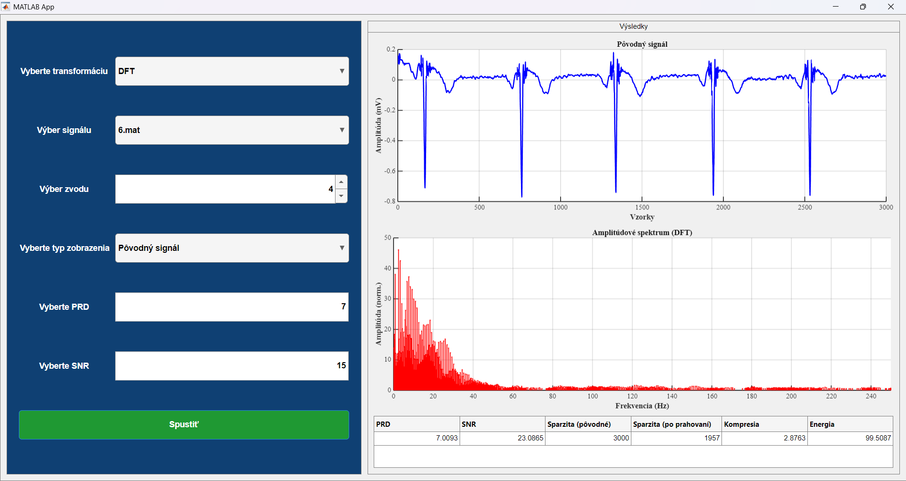
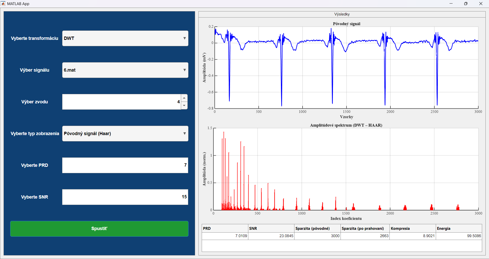
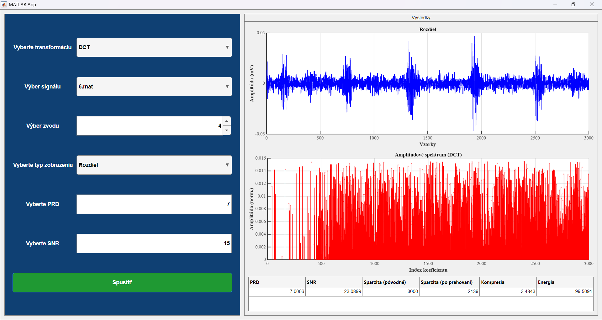

# Analýza sparsity signálov – DFT, DCT, DWT

**Bakalárska práca: Analýza sparsity signálov v DOT**
Porovnanie sparsity a kvality rekonštrukcie pomocou DFT, DCT a DWT.

Autor: Anzhelika Nikolaieva, 2026

[English version](README.md)

---

## Obsah

- [O projekte](#o-projekte)
- [Snímky obrazovky](#snímky-obrazovky)
- [Požiadavky](#požiadavky)
- [Rýchly štart](#rýchly-štart)
- [Štruktúra repozitára](#štruktúra-repozitára)
- [Databáza signálov](#databáza-signálov)
- [Ovládanie aplikácie](#ovládanie-aplikácie)
- [Ako výpočet funguje](#ako-výpočet-funguje)
- [Metriky](#metriky)
- [Výstupy](#výstupy)
- [Poznámky a obmedzenia](#poznámky-a-obmedzenia)

---

## O projekte

Projekt je interaktívna aplikácia vytvorená v **MATLAB App Designer** (`number_2.mlapp`).
Umožňuje na reálnych EKG signáloch porovnať, ako dobre sa signál dá vyjadriť **riedkou (sparse) reprezentáciou**
v troch transformačných doménach:

| Transformácia | Popis |
|---------------|-------|
| **DFT** | diskrétna Fourierova transformácia (FFT) |
| **DCT** | diskrétna kosínusová transformácia (1D) |
| **DWT** | diskrétna waveletová transformácia, 5 úrovní rozkladu, wavelety **Haar** a **db2** |

Pre zvolenú cieľovú kvalitu rekonštrukcie (**PRD** alebo **SNR**) aplikácia nájde **minimálny počet koeficientov**,
ktorý túto kvalitu ešte zaručuje, a zobrazí pôvodný, rekonštruovaný a rozdielový signál spolu so spektrom
a tabuľkou metrík (sparzita, kompresný pomer, zachovaná energia).

## Snímky obrazovky

Všetky snímky používajú signál `6.mat`, zvod 4 a cieľové PRD 7 %.

### Pôvodný signál a spektrum DFT



*Vľavo: ovládacie prvky. Vpravo: pôvodný signál v časovej oblasti (hore), jeho amplitúdové spektrum (v strede) a tabuľka metrík (dole).*

### Rekonštrukcia DFT


*Signál rekonštruovaný z ponechaných koeficientov DFT a jeho spektrum.*

### DWT (Haar)



*DWT s waveletom Haar. Pravý graf zobrazuje absolútne hodnoty waveletových koeficientov podľa indexu koeficientu (aproximačný blok je potlačený len na zobrazenie).*

### DCT: rozdielový signál



*Chyba rekonštrukcie (pôvodný signál mínus rekonštruovaný signál) pri DCT a amplitúdy jej koeficientov DCT.*

### Príklad výsledkov

Hodnoty odčítané z tabuľky metrík na snímkach (signál `6.mat`, zvod 4, cieľové PRD = 7 %):

| Transformácia | PRD [%] | SNR [dB] | Nenulové koeficienty | Kompresný pomer | Zachovaná energia [%] |
|---------------|---------|----------|----------------------|-----------------|-----------------------|
| DFT | 7.0093 | 23.0865 | 1043 | 2.8763 | 99.5087 |
| DCT | 7.0066 | 23.0899 | 861 | 3.4843 | 99.5091 |
| DWT (Haar) | 7.0109 | 23.0845 | 337 | 8.9021 | 99.5086 |

Nenulové koeficienty sa vypočítajú ako `N - Sparzita (po prahovaní)`, kde `N = 3000`. Pri DFT počet zahŕňa kladné aj záporné frekvenčné koeficienty. Hodnoty ilustrujú metriky pre jeden signál a nepredstavujú všeobecné porovnanie transformácií.

## Požiadavky

- **MATLAB R2024b** (verzia, v ktorej bola aplikácia otestovaná), s podporou App Designer. Iné verzie nemusia podporovať všetky vlastnosti rozhrania použité v aplikácii.
- **Signal Processing Toolbox** – funkcie `dct`, `idct`
- **Wavelet Toolbox** – funkcie `wavedec`, `waverec`

## Rýchly štart

1. Stiahnite alebo naklonujte repozitár:
   ```bash
   git clone https://github.com/akill6/signal-sparsity-dot.git
   ```
2. Otvorte MATLAB.
3. Otvorte súbor `number_2.mlapp`.
4. Kliknite na **Run**.
5. V úvodnej obrazovke kliknite na **Začať analýzu**.

> Aplikácia hľadá databázu signálov v priečinku `matDBs/` **vedľa súboru `number_2.mlapp`**.
> Neprenášajte preto `.mlapp` bez priečinka `matDBs`.

## Štruktúra repozitára

```
signal-sparsity-dot/
├── number_2.mlapp   # aplikácia (GUI + výpočty DFT / DCT / DWT)
├── matDBs/          # databáza 200 EKG signálov: 1.mat … 200.mat
├── docs/            # snímky obrazovky použité v tomto súbore
├── READ_ME.txt      # pôvodné stručné pokyny a popis funkcií (SK)
├── README.md        # anglická verzia tohto súboru
├── README.sk.md     # tento súbor (slovenská verzia)
└── .gitignore
```

## Databáza signálov

Priečinok `matDBs/` obsahuje **200 súborov** `1.mat` … `200.mat`.

| Vlastnosť | Hodnota |
|-----------|---------|
| Premenná v každom súbore | `ecgSignal` |
| Rozmer | 5000 × 12 (vzorky × zvody) |
| Typ | `double` |
| Vzorkovacia frekvencia | 500 Hz (nastavená v kóde aplikácie) |

Zo zvoleného zvodu sa analyzuje **prvých 3000 vzoriek** (6 s signálu).
Súbory kratšie ako 3000 vzoriek aplikácia odmietne s chybovým hlásením.
Ak súbor neobsahuje premennú `ecgSignal`, zobrazí sa chyba načítania.

Súbory v zozname sa radia podľa čísla v názve (1, 2, 3 … 200), nie abecedne.

## Ovládanie aplikácie

### 1. Úvodná obrazovka
Tlačidlo **Začať analýzu** skryje úvodný panel, zobrazí hlavný panel a načíta zoznam signálov z `matDBs/`.
Automaticky sa vyberie prvý signál.

### 2. Hlavný panel

| Ovládací prvok | Význam | Rozsah / možnosti |
|----------------|--------|-------------------|
| **Výber signálu** | súbor `.mat` z `matDBs/` | `1.mat` … `200.mat` |
| **Výber zvodu** | číslo zvodu (stĺpca) signálu | 1 – 12 |
| **Vyberte transformáciu** | použitá transformácia | `DFT`, `DCT`, `DWT` |
| **Vyberte PRD** | cieľové PRD v % | 3 – 7 (predvolene 3) |
| **Vyberte SNR** | cieľové SNR v dB | 15 – 25 (predvolene 15) |
| **Spustiť** | spustí výpočet | – |
| **Vyberte typ zobrazenia** | čo sa vykreslí v grafoch | Pôvodný signál / Rekonštruovaný signál / Rozdiel |

**Priorita PRD / SNR.** Aplikácia si zapamätá, ktoré z polí PRD a SNR používateľ upravil **naposledy**, a to použije
ako cieľ optimalizácie (druhé pole sa ignoruje). Ak sa nezmenilo žiadne pole, použije sa PRD.

**Režim DWT.** Pri DWT sa vždy počítajú **oba wavelety (Haar aj db2)** a položky v zozname „Vyberte typ zobrazenia"
sa rozšíria o názov waveletu, napr. `Pôvodný signál (Haar)`, `Rozdiel (db2)`.

**Obnovenie grafov.** Grafy sa prekreslia po stlačení **Spustiť** a pri otvorení rozbaľovacieho zoznamu
**Vyberte typ zobrazenia**.

### 3. Obrazovka s výsledkami
- **Ľavý graf** – signál v časovej oblasti (os x: vzorky, os y: amplitúda v mV)
- **Pravý graf** – amplitúdové spektrum (stem graf)
  - DFT: frekvenčná os 0 – 250 Hz
  - DCT / DWT: index koeficientu
- **Tabuľka metrík** – PRD, SNR, Sparzita (pôvodné), Sparzita (po prahovaní), Kompresia, Energia

## Ako výpočet funguje

Pre všetky tri transformácie platí rovnaký princíp (tvrdé prahovanie podľa veľkosti koeficientov):

1. Z vybraného zvodu sa vezme prvých 3000 vzoriek.
2. Signál sa transformuje (FFT / DCT / DWT).
3. Koeficienty sa zoradia podľa absolútnej hodnoty zostupne.
4. **Binárne vyhľadávanie** nájde počet ponechaných koeficientov `k`:
   - ponechá sa `k` najväčších koeficientov, ostatné sa vynulujú,
   - signál sa rekonštruuje spätnou transformáciou,
   - vypočíta sa PRD a SNR,
   - kritérium: `PRD <= cieľ + 0.01` (pre PRD) alebo `SNR >= cieľ` (pre SNR),
   - zo všetkých vyskúšaných `k` sa vyberie to, ktoré je cieľovej hodnote najbližšie.
5. Vykoná sa konečná rekonštrukcia s najlepším `k` a vypočítajú sa metriky.

Ak binárne vyhľadávanie nenájde vhodný počet koeficientov, použije sa 90 % všetkých koeficientov.

### Zvláštnosti jednotlivých transformácií

**DFT (`computeDFT`)**
- DC zložka sa vždy zachová.
- Zoraďujú sa len kladné frekvencie (bez DC); pri ponechaní frekvencie sa zachová aj jej komplexne združená
  dvojica, takže rekonštruovaný signál ostáva reálny.

**DCT (`computeDCT`)**
- Používa sa 1D DCT, prvý koeficient (DC) sa vždy zachová.

**DWT (`computeDWT`)**
- Viacúrovňový rozklad (`wavedec`), predvolene 5 úrovní.
- Prahujú sa všetky koeficienty spolu (aproximácia aj detaily).
- Výsledky sa ukladajú samostatne pre každý wavelet (`haar`, `db2`), čo umožňuje porovnať sparzitu medzi nimi.

## Metriky

Nech `x` je pôvodný signál, `x̂` rekonštruovaný signál, `e = x − x̂` a `N = 3000`.

| Metrika | Výpočet |
|---------|---------|
| **PRD** (Percent Root Difference) | `sqrt( Σe² / Σx² ) · 100` [%] |
| **SNR** (Signal-to-Noise Ratio) | `10 · log10( Σx² / Σe² )` [dB] |
| **Sparzita (pôvodné)** | `N` (dĺžka signálu) |
| **Sparzita (po prahovaní)** | `N − počet nenulových koeficientov` |
| **Kompresia** (kompresný pomer) | `N / počet nenulových koeficientov` |
| **Energia** (zachovaná energia) | `Σ abs(ponechané koeficienty)² / Σ abs(všetky koeficienty)² · 100` [%] |

## Výstupy

- časový priebeh pôvodného signálu,
- rekonštruovaný signál,
- rozdielový signál (chyba rekonštrukcie),
- spektrálne reprezentácie (pôvodný, rekonštruovaný, rozdielový signál),
- tabuľka metrík.

## Poznámky a obmedzenia

- **Neumiestňujte iné panely nad hlavný panel `app.Panel`** v App Designeri. Databáza signálov sa načíta po stlačení
  tlačidla **Začať analýzu** na tomto paneli, takže ak sa nad `app.Panel` umiestni napr. `app.Panel_2`,
  aplikácia prestane fungovať.
- **Vizualizácia neovplyvňuje numerické metriky.** Na spektrálnych grafoch sa DC zložka (pri DWT aproximačný blok)
  potláča len graficky a zobrazujú sa iba koeficienty s amplitúdou aspoň 1 % maxima. Vo výpočtoch je DC zložka zachovaná
  (pri DFT a DCT).
- Všetky transformácie používajú rovnaké pravidlo prahovania, preto sú výsledky navzájom porovnateľné.
- Panely používajú `BorderType = 'line'`. Hodnota `'etchedin'` nie je v R2024b pre UI figure podporovaná a spôsobí chybu „Functionality not supported with figures created with the uifigure function".
- Rozsahy polí PRD (3 – 7 %) a SNR (15 – 25 dB) sú dané nastavením aplikácie.
- Pôvodný stručný popis funkcií (v slovenčine) je v súbore [`READ_ME.txt`](READ_ME.txt).

## Autor

Anzhelika Nikolaieva, 2026
